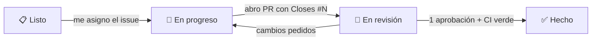

# Cómo trabajamos

Trabajamos como un equipo de ingeniería real: todo cambio entra a `main` por un
Pull Request revisado, y el tablero refleja el estado de cada tarea.

- **Tablero:** https://github.com/users/Slylem0/projects/9
- **Fases:** se siguen con los *milestones* del repositorio.

## Flujo de una tarea



1. Toma un issue de la columna **📋 Listo**, asígnatelo y muévelo a **🚧 En progreso**.
2. Crea una rama desde `main` actualizada:

   ```console
   $ git switch main && git pull
   $ git switch -c feat/12-trabajador-http
   ```

   Prefijos: `feat/` (código nuevo), `infra/` (nube, Docker, K8s), `ci/`,
   `docs/`, `fix/`, `chore/`.
3. Haz commits pequeños con mensajes del tipo *Conventional Commits*:
   `feat(motor): sobel con gx y gy en un solo recorrido`,
   `infra(nube): deployment del trabajador con sondas`.
4. Abre el PR hacia `main` con `Closes #N` en la descripción y llena el checklist.
5. Otro integrante revisa. El CI tiene que estar en verde.
6. **Squash and merge**. El issue se cierra solo y la tarjeta pasa a **✅ Hecho**.

## Reglas que no se negocian

- Nadie empuja directo a `main`; está protegida.
- Cada quien hace commits **desde su propia cuenta de GitHub**. El aporte a
  `main` es parte de la nota individual.
- Ninguna credencial en el repositorio: ni llaves de cuenta de servicio, ni
  tokens de Sonar, ni archivos de `gcloud`. Van en *Secrets* de GitHub.
- Los binarios y las imágenes generadas no se versionan.
- El clúster de GKE se apaga en cuanto termina la medición: el crédito es finito.
